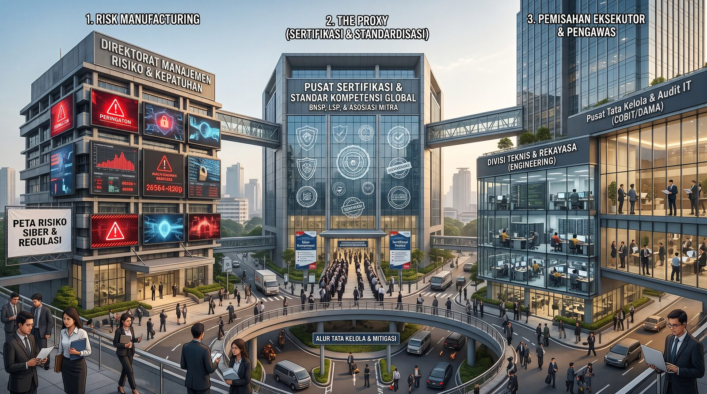

Saya lulusan Teknik Informatika. Bertahun-tahun saya hidup di "inti" dunia IT: menjadi *sysadmin*, menulis kode, membangun perangkat lunak, dan menjaga sistem tetap menyala. Dalam kepala saya, dunia IT hanya punya satu sisi, yaitu sisi orang yang *membuat* dan *menjalankan* teknologi. Belakangan saya baru sadar, dengan sedikit malu, bahwa ada separuh dunia IT lain yang selama ini luput dari pandangan saya padahal selalu ada di depan mata. Separuh dunia itu tidak menulis kode, tetapi justru sering menentukan ke mana kode ditulis, berapa anggarannya, dan siapa yang boleh menulisnya.

Tulisan ini adalah kritik untuk diri saya sendiri, sekaligus catatan tentang apa yang saya lihat setelah kacamata itu dilepas.

{/* truncate */}

## Kacamata yang Saya Pakai Selama Ini

Pendidikan Teknik Informatika mengajarkan algoritma, struktur data, jaringan komputer, sistem operasi, basis data, dan rekayasa perangkat lunak. Hampir tidak ada yang mengajarkan audit, manajemen risiko, kontrak, atau bagaimana dewan direksi mengambil keputusan. Lalu dunia kerja memperkuat pola itu: yang dihargai di lingkungan teknis adalah sistem yang jalan, *bug* yang selesai, dan server yang tidak *down*.

Dari situ tumbuh keyakinan yang diam-diam saya pegang: **kepercayaan datang dari kompetensi.** Kalau sistemnya bagus, orang akan percaya. Dokumen kebijakan, matriks risiko, dan rapat komite saya anggap "urusan kertas", pekerjaan orang yang tidak bisa *coding*. Kadang saya menganggapnya penghambat, kadang sekadar formalitas.

Keyakinan itu tidak sepenuhnya salah, tetapi tidak lengkap. Dan bagian yang tidak lengkap itulah yang ternyata menjadi sumber nafkah, kekuasaan, dan pengaruh bagi separuh dunia IT yang lain.

## Separuh Dunia yang Luput

Ambil contoh DAMA International, asosiasi profesi manajemen data yang menerbitkan DAMA-DMBOK. Misinya berbunyi:

> *DAMA-I serves global data citizens by providing a community space for knowledge sharing, recognizing professional achievement, and promoting ethical and effective data practices, resulting in responsible and effective data management worldwide.*

Bagi orang teknik seperti saya, *data management* identik dengan B-Tree, ACID, replikasi, dan *indexing*. Tetapi tidak ada kata *database*, *schema*, atau *query* di misi itu. Yang ada adalah *knowledge sharing*, *professional achievement*, *ethical*, dan *responsible*. Di dalam DMBOK sendiri, *Data Governance* ditempatkan di tengah "roda" yang dikelilingi area-area teknis seperti arsitektur data, pemodelan, dan integrasi. Teknik tetap ada, tetapi ia diposisikan sebagai sesuatu yang *dikelola*, bukan pusatnya.

Contoh lain adalah ISACA dan kerangka kerja COBIT-nya. Baru-baru ini ISACA Indonesia Chapter mengumumkan kelas publik COBIT 7 selama dua hari dengan biaya Rp 7 juta untuk anggota dan Rp 9 juta untuk non-anggota, plus 17 jam CPE (*Continuing Professional Education*). Pesertanya disebutkan: profesional tata kelola IT, manajer risiko, auditor, dan pemimpin bisnis. Bukan *programmer*, bukan *sysadmin*.

Saya mulai memperhatikan bahwa orang-orang di sisi ini tidak bertanya "bagaimana membuatnya?" seperti yang biasa saya tanyakan. Pertanyaan mereka berbeda:

* Siapa yang bertanggung jawab kalau sistem ini gagal?
* Bagaimana kita *membuktikan* bahwa sistem ini aman, bukan sekadar *yakin* bahwa ia aman?
* Apakah investasi teknologi ini menghasilkan nilai bagi bisnis, atau hanya menghasilkan biaya?
* Apakah kita patuh pada regulasi, dan apa buktinya kalau regulator datang?

Pertanyaan-pertanyaan ini bukan pertanyaan bodoh dari orang yang tidak paham teknologi. Ini pertanyaan dari orang yang *dimintai pertanggungjawaban* oleh pemegang saham, regulator, dan pengadilan, tetapi tidak bisa membuka terminal untuk memeriksa sendiri. Mereka butuh penerjemah antara dunia teknis dan dunia akuntabilitas. Dan profesi tata kelola, risiko, serta kepatuhan lahir untuk mengisi celah itu.

Kesan pertama saya waktu menyadari ini: orang-orang manajemen tampaknya lebih "menguasai" dunia IT daripada orang IT sendiri. Setelah direnungkan, yang mereka kuasai sebenarnya bukan teknologinya, melainkan **anggaran dan keputusannya**. Ada setidaknya tiga alasan mengapa hal ini terjadi secara sistematis, bukan kebetulan.

**Pertama, mereka fasih berbicara dalam bahasa pemilik modal.** Pemegang saham, direksi, dan regulator tidak pernah bertanya "apakah PostgreSQL kita sudah memakai WAL *archiving*?" Mereka bertanya "berapa kerugian kalau sistem mati empat jam?", "apakah proyek ini patuh pada aturan OJK dan UU PDP?", dan "berapa imbal hasil belanja IT tahun ini?" Siapa yang fasih menjawab pertanyaan-pertanyaan itu akan dipercaya memegang persetujuan anggaran (*budget sign-off*). Dan siapa yang memegang anggaran akan menentukan arah, termasuk memilihkan vendor dan kerangka kerja bagi tim teknis.

**Kedua, skala mengubah sifat masalahnya.** Ketika sistem masih dipegang satu tim kecil, keahlian teknis adalah raja karena satu orang bisa melihat seluruh arsitektur dari hulu ke hilir. Tetapi begitu organisasi membesar menjadi ratusan atau ribuan orang lintas divisi, seperti di bank, perusahaan asuransi, atau BUMN, masalah terbesarnya bukan lagi menulis kode, melainkan mengoordinasikan banyak orang agar tidak saling merusak sistem. Melvin Conway sudah mengamati pada 1968 bahwa struktur sebuah sistem cenderung meniru struktur komunikasi organisasi yang membangunnya. Pada skala besar, struktur organisasi ikut menjadi arsitektur. Di ruang koordinasi inilah DMBOK bekerja: menetapkan siapa pemilik data (*data owner*), siapa pengurusnya (*data steward*), dan bagaimana definisi data disepakati lintas departemen.

**Ketiga, orang teknik sendiri enggan masuk ke ruang itu.** Bagian ini akan saya bahas lebih jauh di bawah, karena di sinilah kritik untuk diri saya sendiri dimulai.

## Kompleks Industri Kepercayaan

Kalau disederhanakan, logika yang bekerja di dunia IT modern kira-kira begini:

> "Jika bisnis Anda ingin lancar, gunakan IT. Tetapi IT membawa risiko. Untuk mengimplementasikannya, rekrut SDM lulusan kampus atau lembaga pelatihan ternama. Tetapi mutu pendidikan tidak bisa dijamin, jadi mintalah sertifikasi dari BNSP, lembaga pelatihan, atau asosiasi terkait. Itu baru sisi implementasi. Setiap teknologi yang diterapkan membawa risiko sejak lahir, jadi rekrut juga SDM tata kelola dan manajemen IT, sebaiknya yang bersertifikat dari asosiasi dunia seperti ISACA atau DAMA."

Saya menyebut susunan ini **kompleks industri kepercayaan** (*trust-industrial complex*): sebuah ekosistem yang komoditas utamanya bukan teknologi, melainkan *rasa percaya* terhadap teknologi dan terhadap orang yang mengurusnya. Lapisan-lapisannya saling menopang:

| Lapisan | Contoh | Yang "dijual" |
| :--- | :--- | :--- |
| Penyusun standar dan kerangka kerja | ISO, ISACA (COBIT), DAMA (DMBOK), NIST | Bahasa bersama dan tolok ukur |
| Lembaga sertifikasi | BNSP dan LSP, ujian CISA/CISM/CDMP | Bukti bahwa seseorang kompeten |
| Lembaga pelatihan | LPK, *accredited trainer*, kelas publik | Jalan menuju sertifikat |
| Auditor dan asesor | Kantor audit, badan sertifikasi ISO 27001 | Bukti bahwa sebuah organisasi patuh |
| Konsultan | Konsultan tata kelola, risiko, kepatuhan | Jalan menuju lulus audit |
| Regulator | OJK, BSSN, UU Pelindungan Data Pribadi | Kewajiban yang menggerakkan semuanya |

Roda gilanya berputar sendiri. Regulasi menciptakan kebutuhan audit. Audit menciptakan kebutuhan orang bersertifikat. Sertifikasi menciptakan kebutuhan pelatihan. Sertifikat harus dipelihara dengan jam CPE setiap tahun, sehingga pelatihan menjadi pendapatan berulang. Kerangka kerja diperbarui dari satu versi ke versi berikutnya, sehingga semua orang perlu belajar ulang. Dan setiap kali ada insiden besar yang masuk berita, roda itu berputar lebih kencang.

Kalau dibedah lebih dalam, ada beberapa mekanisme yang membuat roda ini bukan sekadar berputar, tetapi juga menguntungkan:

* **Komodifikasi ketidakpastian.** Setiap teknologi baru membawa kompleksitas yang tidak dipahami pengambil keputusan non-teknis. Ketidaktahuan itu dikemas ulang menjadi narasi risiko: risiko siber, risiko kepatuhan, risiko kegagalan proyek. Begitu rasa takut terbentuk, pasar membutuhkan penawarnya, yaitu kerangka kerja tata kelola.
* **Treadmill kredensial.** Sertifikat tata kelola dan audit seperti CISA, CRISC, atau CGEIT tidak berlaku seumur hidup. Pemegangnya wajib mengumpulkan jam CPE setiap tahun dan membayar iuran agar gelarnya tidak dicabut. Hasilnya adalah pasar berulang yang terkunci (*captive recurring market*): orang terus ikut kelas, seminar, dan konferensi demi menjaga status, terlepas dari apakah materinya memecahkan masalah di kantor mereka.
* **Monetisasi penerjemahan.** Dokumen kerangka kerja global itu tebal dan abstrak. Asosiasi dan *accredited trainer* menjual jasa menerjemahkannya menjadi kelas terstruktur belasan jam yang siap dikonsumsi auditor, manajer risiko, dan pimpinan IT. Semakin rumit kerangka kerjanya, semakin besar kebutuhan akan penerjemah.
* **Siapa yang membayar.** Kelas teknis murni, seperti administrasi Linux atau pengembangan aplikasi, sering kali dibayar sendiri oleh pesertanya atau oleh tim operasional yang anggarannya terbatas, sehingga harganya tidak bisa terlalu tinggi. Kelas tata kelola dibayar dari anggaran pelatihan korporat untuk peserta level manajer ke atas. Tidak heran harganya bisa mencapai Rp 7 juta hingga belasan juta rupiah untuk dua sampai tiga hari.
* **Pemisahan pembangun dan penjaga.** Dengan memisahkan "tukang bangun" (SDM teknis) dari "tukang jaga risiko" (SDM tata kelola bersertifikat), ekosistem ini menciptakan dua ceruk pasar yang saling mengunci. Masing-masing membutuhkan rantai sertifikasinya sendiri.

Ini bukan teori konspirasi. Ekonom sudah lama menjelaskan mekanismenya. George Akerlof menunjukkan bahwa pasar rusak ketika pembeli tidak bisa menilai kualitas barang yang dibelinya (*market for lemons*). Michael Spence menunjukkan bahwa dalam kondisi seperti itu, orang membeli *sinyal* sebagai pengganti kualitas: ijazah, sertifikat, merek. Ada pepatah lama di dunia IT: *"nobody ever got fired for buying IBM."* Tidak ada yang dipecat karena memilih vendor yang dikenal semua orang, karena keputusan itu mudah dibela, terlepas dari apakah itu keputusan terbaik. Sertifikat bekerja dengan cara yang sama. Ia tidak menjamin seseorang kompeten di lapangan, tetapi ia menjadi tameng administratif bagi yang merekrut kalau kelak terjadi masalah: "kami sudah merekrut personel bersertifikat internasional."

Dewan direksi tidak bisa menilai kualitas kode saya. Mereka bisa menilai apakah saya punya sertifikat, apakah perusahaan saya lulus audit ISO 27001, dan apakah ada dokumen kebijakan yang bisa ditunjukkan kepada regulator. **Di pasar yang penuh asimetri informasi, kepercayaan tidak diberikan kepada yang paling kompeten, melainkan kepada yang paling bisa dibuktikan.**

## Kritik ke Dua Arah

Kompleks industri kepercayaan ini layak dikritik. Ia hidup dari rasa takut, dan rasa takut adalah barang dagangan yang mudah dijual. Ia rawan melahirkan *governance theater*: dokumen ratusan halaman yang lulus audit tetapi tidak pernah dibaca tim teknis, atau kontrol yang ada di atas kertas tetapi tidak berjalan di server. Ia juga terkena hukum Goodhart: ketika ukuran dijadikan target, ukuran itu berhenti menjadi ukuran yang baik. Lulus audit menjadi tujuan, bukan keamanan itu sendiri. Dan biayanya yang tinggi menjadi tembok bagi perusahaan kecil yang secara teknis mampu tetapi tidak sanggup membayar seluruh rantai sertifikasi.

Ironi terbesarnya muncul ketika panggung IT dikuasai penuh oleh sisi manajemen tanpa diimbangi praktisi teknis di meja pengambil keputusan. Tata kelola menjadi abstrak dan terputus dari realitas mesin. Sebuah organisasi bisa merumuskan misi mulia tentang *ethical and effective data practices*, menyusun ratusan halaman kebijakan, dan menggelar konferensi megah, tetapi tidak tahu bahwa di lapisan paling bawah data pelanggannya masih tersimpan sebagai teks polos (*plaintext*), atau servernya masih diakses dengan satu *password* yang dipakai bersama. Perusahaannya penuh gelar dan piagam, tetapi arsitektur IT-nya tetap keropos ketika diuji insiden nyata. Rantai kepercayaan berubah menjadi **ritual mahal yang rapuh**.

Rantai itu sebenarnya hanya sehat jika sertifikasi dan kerangka kerja diperlakukan sebagai **akselerator kompetensi nyata, bukan penggantinya**. Ketika seorang praktisi yang sudah teruji di ruang mesin mempelajari COBIT atau manajemen risiko, ia mendapat alat komunikasi dan legitimasi agar keputusan teknisnya diterima direksi dan regulator. Ketika sistem ini justru memproduksi lulusan yang hafal istilah COBIT dan DMBOK tetapi tidak pernah menyentuh konfigurasi sistem, yang lahir adalah ritual tadi.

Tetapi kritik yang lebih besar justru harus saya arahkan ke diri sendiri.

Saya, seperti banyak orang teknik lain, lebih nyaman berurusan dengan sistem yang deterministik, yaitu mesin dan kode, daripada bernegosiasi dengan birokrasi, politik kantor, dan regulasi. Mesin tidak punya kepentingan. Rapat anggaran punya. Akibatnya, kursi-kursi pengambil keputusan, mulai dari CIO, CDO (*Chief Data Officer*), hingga pengurus asosiasi profesi, ditinggalkan kosong oleh orang teknik lalu diisi oleh orang berlatar belakang manajemen, konsultan bisnis, atau hukum. Lalu kami mengeluh bahwa keputusan IT dibuat oleh orang yang tidak paham IT.

Selama bertahun-tahun saya menganggap kepercayaan akan datang dengan sendirinya kalau pekerjaan teknis saya bagus. Saya tidak pernah bertanya bagaimana orang yang tidak bisa membaca kode akan *tahu* bahwa pekerjaan saya bagus. Saya meremehkan pertanyaan "apa buktinya?" sebagai birokrasi, padahal itu pertanyaan yang sah dari orang yang menanggung risiko atas keputusan yang tidak bisa ia periksa sendiri. Saya menyalahkan "orang manajemen" karena mengatur dunia IT, padahal sebagian ruang itu kosong karena orang teknik seperti saya tidak pernah mau mengisinya.

Kompleks industri kepercayaan tumbuh subur sebagian karena orang teknik gagal menjelaskan diri. Ketika kita tidak bisa menerjemahkan kompetensi menjadi bukti, orang lain akan menjual terjemahannya, lengkap dengan sertifikat dan jam CPE.

## Pelajaran untuk Orang Teknik (Termasuk Saya)

* **Kompetensi yang tidak bisa dibuktikan, di mata pasar, sama dengan tidak ada.** Jejak audit, log, dokumentasi, dan bukti uji bukan formalitas. Itulah cara pekerjaan teknis dibaca oleh orang yang tidak bisa membaca kode.
* **Pelajari bahasanya, bukan hanya teknologinya.** Risiko, nilai bisnis, akuntabilitas, kontrol, pengecualian. Kerangka kerja seperti COBIT atau DMBOK tidak perlu dihafal, tetapi perlu dipahami cara berpikirnya.
* **Kerangka kerja sengaja netral teknologi.** Ia menentukan *apa* yang harus ada, bukan *bagaimana* membangunnya. Di bagian "bagaimana" itulah orang teknik justru punya keunggulan, asalkan ia mau terlibat.
* **Perlakukan sertifikat sebagai alat, bukan tujuan.** Sertifikasi dan keanggotaan asosiasi berguna untuk membuka pintu korporasi dan regulator. Tetapi nilainya ada pada arsitektur benar yang berhasil dijalankan berkat legitimasi itu, bukan pada jumlah jam CPE atau deretan gelar di belakang nama.
* **Duduklah di meja pengambil keputusan.** Bukan untuk menjadi juru ketik kebijakan yang disusun orang lain, melainkan untuk memastikan tata kelola tetap berpijak pada realitas rekayasa sistem.
* **Jangan berhenti kritis.** Memahami cara kerja kompleks industri kepercayaan tidak sama dengan menerimanya bulat-bulat. Tata kelola yang baik melayani bisnis dan keamanan nyata, bukan sekadar meluluskan audit.

Pertanyaan yang tersisa bagi saya: apakah ada titik tengah antara orang teknik yang gesit tetapi tidak bisa membuktikan apa-apa, dan organisasi yang rapi secara tata kelola tetapi lumpuh karena birokrasinya sendiri? Saya akan mencoba menjawabnya di tulisan berikutnya.

---

<small>Catatan: penyusunan redaksi dan ilustrasi tulisan ini dibantu AI, yaitu Claude Opus 5.5 dari Anthropic dan Gemini 4 Hydrogen dari Google.</small>
